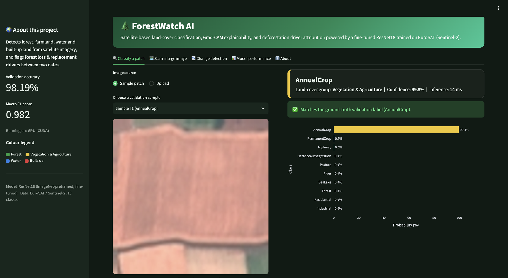
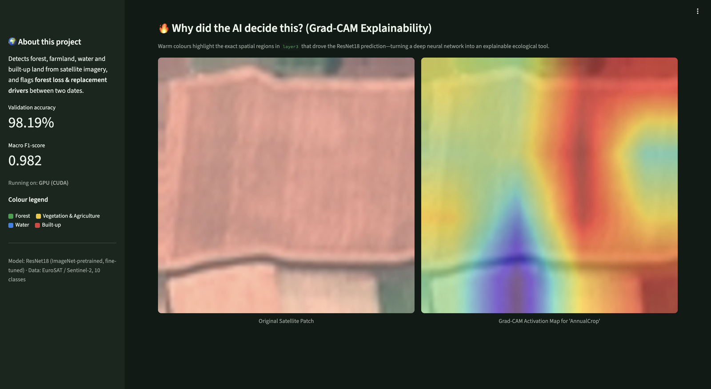
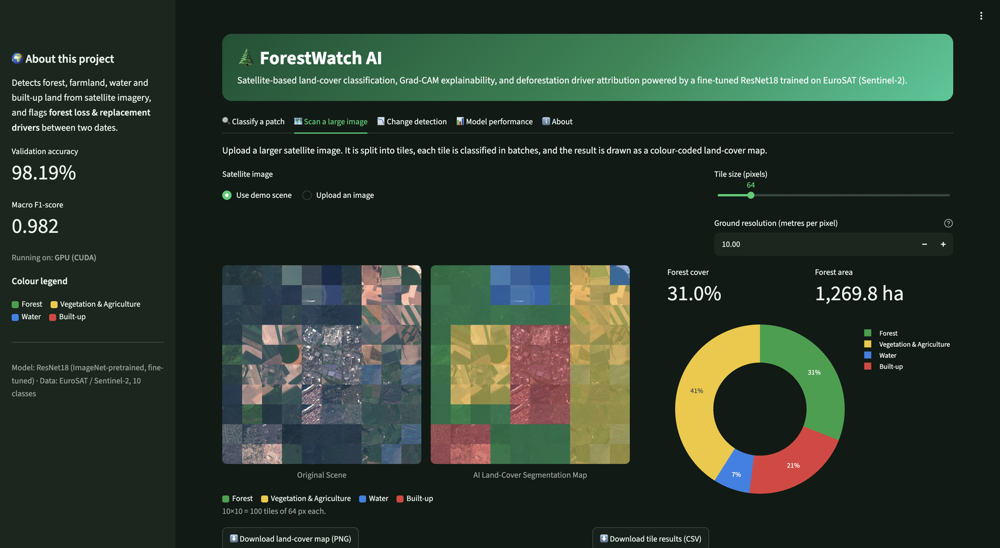
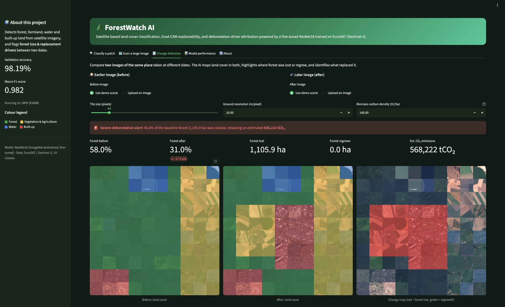
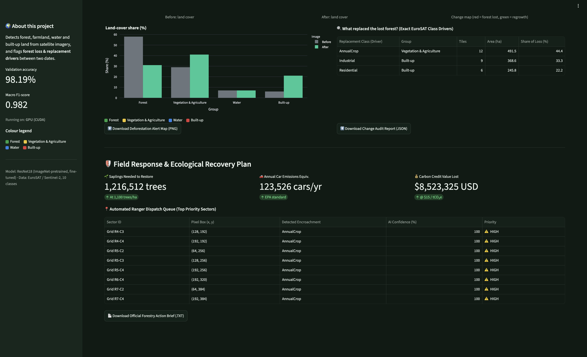
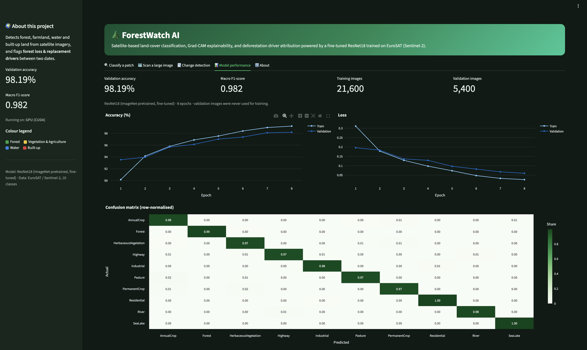
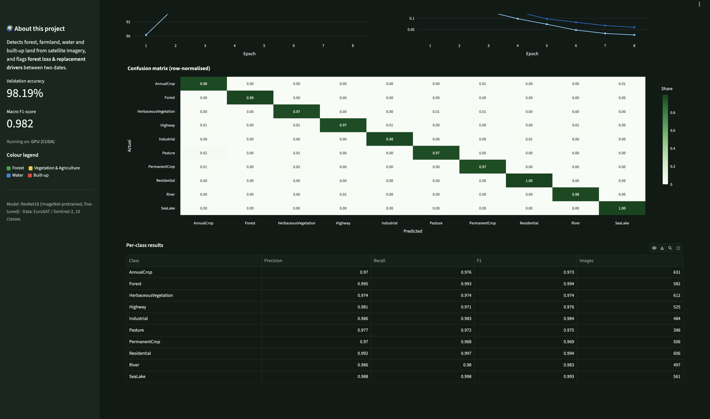
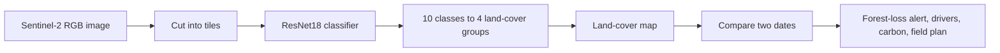

# 🌲 ForestWatch AI

**Explainable satellite AI that maps land cover, detects forest loss between two dates, and turns it into an action plan.**
[Open In Colab](https://colab.research.google.com/assets/colab-badge.svg)][https://colab.research.google.com/github/UTSAV10MAX/forest-cover-ai/blob/main/Forest_Classifier_Model.ipynb]


🔗 **Live demo:** _add your Hugging Face Space link here_  ·  🎬 **Demo video:** _add your video link here_

---

## Table of contents
[The problem](#-the-problem) · [What it does](#-what-it-does) · [Screenshots](#-screenshots) · [How it works](#-how-it-works) · [Results](#-model-results) · [Run it](#-run-it) · [Repository layout](#-repository-layout) · [Limitations](#-limitations-and-honest-notes) · [Roadmap](#-roadmap) · [Credits](#-credits)

---

## 🚨 The problem

Forests are being cleared faster than anyone can inspect them. According to Global Forest Watch (WRI and the University of Maryland), the tropics lost primary forest at roughly **10 football fields per minute** in 2021 to 2023, and a record **18 per minute in 2024**. Satellites photograph the whole planet every few days, but nobody can review that imagery by hand, so clearing is often noticed months too late.

Two more gaps make this worse:

- Most image classifiers are **black boxes**: they output a label but never say *why*.
- Knowing that forest was lost is not enough. Teams also need to know **what replaced it** and **where to go first**.

## 💡 What it does

ForestWatch AI is a Streamlit web app on top of a **ResNet18** classifier fine-tuned on **27,000 Sentinel-2 satellite patches (EuroSAT)**. It has five tabs (Classify, Scan, Change detection, Model performance, About). These are the main features:

| Tab | What it gives you |
|---|---|
| 🔍 **Classify a patch** | Land-cover class, confidence, a probability chart over all 10 classes, and inference time (about 14 ms on a Colab T4 GPU). |
| 🔥 **Grad-CAM explainability** (in the same tab) | A heatmap of the image regions that drove the prediction, so analysts can check the AI's reasoning. |
| 🗺️ **Scan a large image** | Splits a large scene into tiles, classifies each tile, and draws a colour-coded land-cover map with forest cover (%) and area (hectares). Exports a PNG map and a per-tile CSV. |
| 📉 **Change detection** | Compares a *before* and an *after* image of the same place. Shows forest lost and regrown, flags the severity, and identifies **what replaced the forest** (for example crops, industry or housing). |
| 🛡️ **Field response plan** (in the Change tab) | Estimated CO₂ released, saplings needed to restore, car-emissions equivalent, carbon-credit value lost, and a ranked **ranger dispatch queue** of the affected grid sectors. Exports an alert-map PNG, a JSON audit report and a TXT action brief. |
| 📊 **Model performance** | Training curves, a 10×10 confusion matrix and per-class precision, recall and F1, all computed on held-out images. |

---

## 📸 Screenshots

| 🔍 Classification with probabilities | 🔥 Grad-CAM explainability |
| :---: | :---: |
|  |  |

| 🗺️ Large-scene land-cover map |
| :---: |
|  |

| 📉 Before / after change detection |
| :---: |
|  |

| 🛡️ Field response and recovery plan |
| :---: |
|  |

| 📊 Model performance | 🧮 Confusion matrix and per-class metrics |
| :---: | :---: |
|  |  |

> The change-detection screenshots use the built-in **demo scene**, a synthetic before/after mosaic assembled from real EuroSAT validation patches. It demonstrates the pipeline and is **not a real deforestation event**. See [Limitations](#-limitations-and-honest-notes).

---

## 🧠 How it works



**1. Classification.** Every tile is resized to 64×64, normalised with ImageNet statistics and passed through ResNet18. A softmax turns the output into class probabilities.

**2. Land-cover groups.** The 10 EuroSAT classes are merged into 4 groups used on every map:

| Group | EuroSAT classes | Map colour |
|---|---|---|
| 🟢 Forest | Forest | green |
| 🟡 Vegetation & Agriculture | AnnualCrop, HerbaceousVegetation, Pasture, PermanentCrop | yellow |
| 🔵 Water | River, SeaLake | blue |
| 🔴 Built-up | Highway, Industrial, Residential | red |

**3. Explainability.** Grad-CAM hooks into `layer3` of ResNet18. For a 64×64 input, `layer3` gives a 4×4 feature grid, which is finer than the 2×2 grid of `layer4`.

**4. Large images.** The scene is cut into square tiles (32 to 256 px, adjustable). The area of one tile is:

```
tile area (ha) = (tile_pixels x metres_per_pixel)^2 / 10,000
```

Sentinel-2 RGB is 10 m per pixel, so a 64 px tile covers about 40.96 ha.

**5. Change detection.** Both images are tiled on the same grid. A tile counts as *lost* if it is Forest in the earlier image and not Forest in the later one, and as *regrown* in the opposite case. The class predicted on the later image for each lost tile tells you **what replaced the forest**.

**6. Impact estimates.** These are illustrative and every default can be changed in the app:

| Estimate | Default assumption |
|---|---|
| CO₂ released | lost hectares × 140 tC/ha (editable) × 44/12 |
| Restoration | 1,100 saplings per hectare |
| Car equivalent | typical EPA passenger-car figure per year |
| Carbon-credit value | US$15 per tCO₂e |

### Example output on the demo scene

| Metric | Value |
|---|---|
| Forest cover, before → after | 58.0% → 31.0% |
| Forest lost | 27 tiles, 1,105.9 ha (46.6% of the earlier forest) |
| Replaced by | AnnualCrop 44.4%, Industrial 33.3%, Residential 22.2% |
| Estimated CO₂ at 140 tC/ha | 568,222 tCO₂ |

---

## 📈 Model results

Fine-tuned ResNet18 (ImageNet-pretrained), trained on an 80/20 split with a fixed seed.

| Item | Value |
|---|---|
| Training / validation images | 21,600 / 5,400 |
| **Validation accuracy** | **98.19%** |
| **Macro F1-score** | **0.982** |
| Forest class (582 val images) | precision 0.995 · recall 0.993 · F1 0.994 |
| Weakest class | PermanentCrop, F1 0.969 |
| Epochs / optimiser / schedule | 8 · AdamW (lr 5e-4, weight decay 1e-4) · cosine annealing |
| Augmentation | random horizontal and vertical flips (training only) |
| Inference | about 14 ms per patch on a Colab T4 GPU |

For context, the original EuroSAT paper reports 98.57% overall accuracy with deep CNNs, so this result is in line with published benchmarks. EuroSAT is generally considered a fairly easy benchmark, so the number shows the model learned the dataset well, not that it will match this accuracy on any region.

The full training curves, confusion matrix and per-class table are in the app's **Model performance** tab and in `metrics.json`.

---

## 🚀 Run it

### Option A: Google Colab (free GPU)

1. Open `Forest_Classifier_Model.ipynb` in Colab and set **Runtime → Change runtime type → T4 GPU**.
2. Download the **EuroSAT RGB** dataset from the [official repository](https://github.com/phelber/EuroSAT) and arrange it as `dataset/EuroSAT/<ClassName>/*.jpg`.
3. Run **Cell 1** (train and evaluate). It writes `forest_cnn_model.pth` and `metrics.json`.
4. Run **Cell 2**. It writes `samples/` (validation patches and the demo before/after scenes).
5. Upload `app.py` to the Colab file panel, then run **Cell 3**. It prints a public `https://*.trycloudflare.com` link.

### Option B: Run locally

```bash
git clone https://github.com/YOUR_USERNAME/forestwatch-ai.git
cd forestwatch-ai
pip install -r requirements.txt
streamlit run app.py
```

The repository includes the trained weights, `metrics.json` and `samples/`, so no retraining is needed.

### Option C: Deploy a permanent link on Hugging Face Spaces

1. Create a new Space at huggingface.co and choose the **Streamlit** SDK.
2. Upload `app.py`, `requirements.txt`, `forest_cnn_model.pth`, `metrics.json`, `samples/` and `.streamlit/config.toml`.
3. Put this block at the very top of the Space's `README.md`:

```yaml
---
title: ForestWatch AI
emoji: 🌲
colorFrom: green
colorTo: green
sdk: streamlit
app_file: app.py
pinned: false
---
```

> The weights file is about 45 MB. On GitHub, push it with `git` or Git LFS rather than the browser uploader, which has a smaller per-file limit.

---

## 📂 Repository layout

```
├── app.py                        # 5-tab Streamlit application
├── Forest_Classifier_Model.ipynb # training, evaluation, demo-sample and launch cells
├── forest_cnn_model.pth          # trained ResNet18 weights (about 45 MB)
├── metrics.json                  # accuracy, F1, curves, confusion matrix, per-class results
├── samples/                      # validation patches and synthetic before/after scenes
├── screenshots/                  # images used in this README
├── .streamlit/config.toml        # dark green theme
├── requirements.txt
└── README.md
```

---

## 🚧 Limitations and honest notes

- **The demo scenes are synthetic.** They are built from real EuroSAT validation patches arranged into a before/after mosaic so the pipeline can be shown on demand. The 46.6% forest-loss result is not a real event.
- **European training data.** EuroSAT covers 34 European countries. Accuracy on other regions, forest types (for example tropical forest), seasons or sensors must be validated, and the model should be retrained on local imagery before real-world use.
- **Optimistic validation.** The 98.19% comes from a random 80/20 patch split. Patches from the same satellite scenes can land in both sets, so accuracy on new areas is expected to be lower.
- **Change detection compares two classified maps.** A mistake in either image, or a seasonal difference such as harvested fields or dry leaves, can look like change. Use images of the same area, zoom and season.
- **Very high confidence on the demo.** Confidence values near 100% appear because the demo tiles are clean, in-distribution EuroSAT patches. Real screenshots will usually score lower.
- **Impact numbers are estimates.** CO₂, saplings, car equivalents and carbon-credit value use adjustable default assumptions and are not audited figures.
- **RGB only.** Multispectral bands such as NIR (for NDVI) are not used yet.
- **A screening tool.** It helps teams decide where to look first. It is not a legal or enforcement verdict.

## 🛣️ Roadmap

- Retrain on regional, multi-season imagery and report accuracy on a spatially separated test set
- Use the 13-band multispectral EuroSAT data and add NDVI-based change detection
- Pull imagery for a chosen area directly from the Sentinel-2 archive
- Time-series monitoring with automatic alerts
- Georeferenced outputs (GeoTIFF or GeoJSON) for GIS tools

---

## 🙏 Credits

- **Data:** EuroSAT, Helber, Bischke, Dengel and Borth, *EuroSAT: A Novel Dataset and Deep Learning Benchmark for Land Use and Land Cover Classification*, IEEE JSTARS, 2019. Built from Copernicus Sentinel-2 imagery.
- **Model:** ResNet, He et al., *Deep Residual Learning for Image Recognition*, CVPR 2016.
- **Explainability:** Grad-CAM, Selvaraju et al., ICCV 2017.
- **Forest-loss statistics:** Global Forest Watch (World Resources Institute and the University of Maryland).
- **Built with:** PyTorch, torchvision, Streamlit, Plotly, Pillow, NumPy and pandas.

**Author:** Utsav
